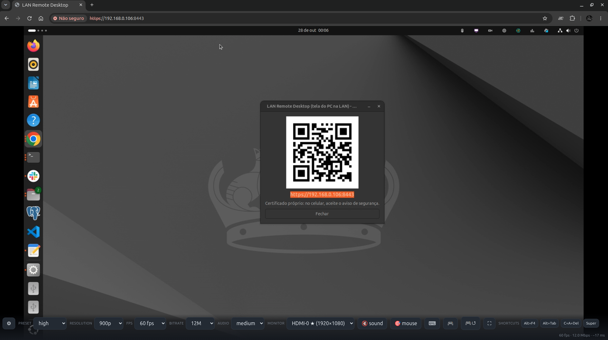
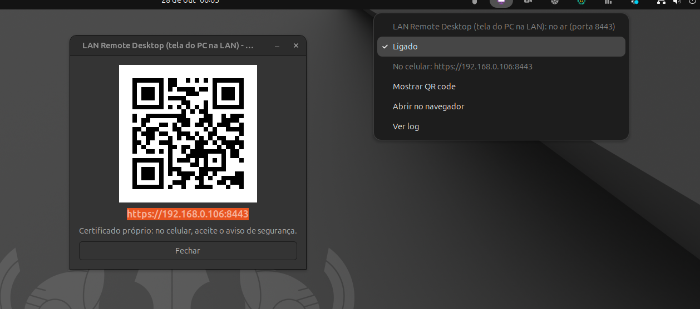

<div align="center">

# LAN Remote Desktop

**The PC screen on any device of the local network through the browser, with mouse, keyboard and Xbox gamepad, at the lowest latency a browser allows.**


[](https://github.com/gabrielogregorio/devkit-lan-remote-desktop/actions/workflows/tests.yml)
[](https://github.com/gabrielogregorio/devkit-lan-remote-desktop/actions/workflows/check-quality.yml)
[](https://github.com/gabrielogregorio/devkit-lan-remote-desktop/actions/workflows/codeql-analysis.yml)

<br>



</div>

## About

Share the screen of an **Ubuntu** PC with **any device on the local network** (tablet, Android
phone, another laptop) **through the browser**, and control the PC from it with **mouse, keyboard
and an Xbox gamepad**. High frame rate and low input lag; nothing to install on the device.

```bash
./run.sh
```

Open the address it prints (e.g. `https://192.168.0.101:8443`) in the other device's browser.

> **Same network required.** The device and the PC must be on the same local network (same Wi-Fi
> or the same router, cable counts). The page is reached by the PC's local IP
> (`https://<pc-ip>:8443`); nothing goes through the internet, so it does not work from another
> network or over mobile data. A guest Wi-Fi with client isolation also blocks it.

- 🖥️ **Screen:** hardware H.264 (NVENC, VAAPI or x264 as fallback) decoded frame by frame with
  WebCodecs, no MSE/HLS buffer. Pick the monitor, the resolution, fps and bitrate live.
- 🔊 **Sound:** what the PC plays, in Opus, with a short jitter buffer (~60 ms).
- 🖱️ **Mouse and touch:** absolute pointer, tap to click, drag to move; pointer lock (relative mouse)
  for games.
- ⌨️ **Keyboard:** the device's physical keyboard, an on-screen keyboard and shortcut buttons
  (Alt+F4, Alt+Tab, Ctrl+Alt+Del, Super).
- 🎮 **Xbox gamepad:** a controller plugged into the device drives a **virtual Xbox 360 pad** on the
  PC (`045e:028e`) that games and Steam see as real. Non-standard PS2/USB clones get a remap wizard.
- 🛡️ **Anti-ban guard:** it does not start, and shuts down at once, when an anti-cheat or an online
  game from its list is running ([ANTIBAN.md](ANTIBAN.md)).
- 🌐 **Language:** the page follows the browser (`pt*` shows Brazilian Portuguese, anything else
  English; force one with `?lang=en` or `?lang=pt-BR`); the guard notices follow the system
  language.

Built and tested on Ubuntu 24.04 (X11).

## Set up on a new PC

1. **X11 session** (Xorg). On Ubuntu 24.04: login screen → gear in the corner → "Ubuntu on Xorg".
   Wayland is not supported (the capture is `x11grab`).
2. **Packages:**
   ```bash
   sudo apt install ffmpeg openssl python3 python3-venv acl
   ```
   Hardware encoder (optional, it falls back to x264): NVIDIA = proprietary driver
   (`nvidia-driver-*`, brings NVENC); Intel/AMD = `intel-media-va-driver` or `mesa-va-drivers`.
3. **Clone, grant input access and start:**
   ```bash
   git clone <repo-url> devkit-lan-remote-desktop
   cd devkit-lan-remote-desktop
   ./run.sh setup   # /dev/uinput: udev rule + input group (sudo); then log out and back in once
   ./run.sh         # creates .venv and the certificate the first time and prints the address
   ```
4. **On the other device:** Chrome or Edge at the printed address; accept the certificate warning
   (self-signed) the first time.
5. **Top bar icon (optional):** `./tray_icon.py --install` puts an icon on the top bar at every
   login, gray while off. Its menu turns the server on and off; turning it on opens a QR code with
   the address, so the device does not need it typed:

   

   The menu follows the system language (the screenshot is in Brazilian Portuguese: Ligado = On,
   Mostrar QR code = Show QR code). The address is the PC's local IP, so the QR code only works on
   the same network. Without `python3-segno` the QR window shows only the address.
   `./tray_icon.py --remove` takes the icon out of the login.
   The icon runs on the system python3 and needs `sudo apt install python3-gi gir1.2-gtk-3.0
   gir1.2-ayatanaappindicator3-0.1` (already on a standard Ubuntu desktop) plus `python3-segno` for
   the QR code.

   Menu: the status line ("LAN Remote Desktop (PC screen on the LAN): on air (port 8443)"),
   **On** (starts or stops the server), the address for the device, **Show QR code**, **Open in
   the browser**, **View log** (the server output). A middle click on the icon toggles it.
6. **Tests (optional):** `npm ci` (needs `nodejs`/`npm`), then see [Tests](#tests).

**Outside the repository:**

| Path | What |
|---|---|
| `.venv/` | Python venv (`--system-site-packages`), made by `./run.sh` when aiohttp/evdev are missing; ignored by git |
| `certs/cert.pem`, `certs/key.pem` | self-signed TLS pair with the LAN IPs, made by `./run.sh`; ignored by git (private key) |
| `~/.config/devkit-lan-remote-desktop/gamepad-map.json` | saved gamepad remap profiles (`LRD_GAMEPAD_MAP` moves it) |
| `/etc/udev/rules.d/99-lan-remote-desktop-uinput.rules` | `/dev/uinput` for the `input` group, from `./run.sh setup` |
| `~/.config/autostart/devkit-lan-remote-desktop-tray.desktop` | starts the top bar icon at login, off (`./tray_icon.py --install`; `--remove` takes it out) |
| `~/.local/share/applications/devkit-lan-remote-desktop-tray.desktop` | app menu shortcut for the icon (same command) |
| `~/.cache/devkit-lan-remote-desktop/` | the icon's `server.log` ("View log"), on/off SVGs, the QR code PNG and its lock |

Changed the network or the IP and the browser complains about the certificate? Move `certs/` to
`trash/` and run `./run.sh` again: a new pair is made with the current IPs.

## Available scripts

```bash
# Run
./run.sh                    # port 8443
./run.sh --port 9000        # another port
./run.sh setup              # grant /dev/uinput access (once, with sudo)
LRD_PRESET=low ./run.sh     # start lighter

# Top bar icon (on/off, QR code), at every login
./tray_icon.py --install
./tray_icon.py --remove

# Test (never opens /dev/uinput: nothing moves your mouse)
./run-tests.sh                                     # lint + server (100% gate) + web client
npx playwright install chromium-headless-shell     # once, for the E2E
RUN_E2E=1 ./run-tests.sh                           # + E2E (real server + Chromium)

# Guard
.venv/bin/python -m server.guardian --check   # exit 0 = clean, 3 = blocked
.venv/bin/python -m server.guardian --list    # everything it blocks

# Dependencies (uv)
uv lock && uv export --frozen --no-dev --no-emit-project --no-hashes -o requirements.txt
```

## Tests

| Kind | Where | What it covers |
|---|---|---|
| **Lint** | `pyproject.toml` (ruff), ShellCheck | Python style, import order, bug patterns; warnings in every `.sh` |
| **Server unit** | `tests/test_*.py` (pytest) | hubs and queues, encoder detection and the ffmpeg command, Access Unit slicing, Ogg/Opus parser, uinput writes (fake), key map, gamepad profiles, guard (Linux and Windows), i18n catalog |
| **Integration** | `tests/test_integration_ws.py` | the aiohttp app over real WebSockets: keyframe gating, fan-out, `reset` on preset change, audio following the preset, monitor switch, hostile payloads that must not drop the input channel |
| **Fuzz / property** | `tests/test_fuzz_input.py`, `tests/test_parsers_property.py`, `web/__tests__/protocol.test.js` | any input stays inside the device ranges and every gamepad frame ends in `syn()`; parsers give the same output however the stream is split |
| **Entry point** | `tests/test_script.py` | `run.sh` in a sandbox with fake `ffmpeg`/`openssl`/`python3`/`sudo`: port, TLS, guard blocking, uinput without permission, `setup` |
| **Web client** | `web/__tests__/*.test.js` (Vitest + jsdom) | decoder, audio, mouse/touch/keyboard, on-screen keyboard, remap, UI, stats, boot, i18n catalog and language detection |
| **E2E** | `web/e2e/*.spec.js` (Playwright) | real server + Chromium: the UI loads and connects, presets and sound, the `/api/*` contract, garbage on `/ws/input` without dropping it, pt-BR page |
| **Docs drift** | `tests/test_docs_sync.py` | every endpoint, message type, preset and `LRD_*` variable in the code appears in `CLAUDE.md`/`README.md` |

Gates: **100%** line + branch coverage on `server/` (`pyproject.toml`); 95% lines/functions/
statements and 90% branches on the client (`vitest.config.js`). The E2E server runs with
`LRD_GUARDIAN=off LRD_INPUT=off`, and the screen capture test skips itself without `DISPLAY`.
How to write a new test: [TESTING.md](TESTING.md).

## CI/CD

GitHub Actions, in `.github/`:

| Workflow | When | What |
|---|---|---|
| `tests.yml` | push/PR to `main`, manual | unit layers (lint, server with the coverage gate, web client), then the E2E with Playwright against the real server; the Playwright report is uploaded when it fails |
| `check-quality.yml` | push/PR to `main` | ruff, ShellCheck, JavaScript syntax, `.sh` files executable in git, actions pinned to a hash, workflow YAML |
| `codeql-analysis.yml` | push/PR, weekly | CodeQL for Python, JavaScript/TypeScript and the workflows |
| `auto-complete-fields.yml` | PR opened/updated | assigns the author, labels by commit words and touched files, lists the commits in the PR body (`[...autoGenerate]`), titles it `Release vX.Y.Z - …`, fails if that version was already released |
| `create-tag-and-release.yml` | PR merged into `main` | creates the tag `vX.Y.Z` from `VERSION` and a GitHub release with the PR text, generated notes, the source tarball and `SHA256SUMS` (a `-rc.1` style version becomes a pre-release) |

`setup-environment` (composite action) sets up Node, creates the venv from `requirements-dev.txt`,
runs `npm ci` and, for the E2E, installs Chromium and makes a throwaway certificate in `certs/`.

**Pinned versions.** Every third-party action is pinned to the full commit hash of its release tag,
with the version as a comment, so a moved or hijacked tag cannot change what runs:

| Action | Version | Commit |
|---|---|---|
| `actions/checkout` | v6.1.0 | `d23441a48e516b6c34aea4fa41551a30e30af803` |
| `actions/setup-node` | v7.1.0 | `949feb2413d6458794dcd2491c4babbbce0c15c1` |
| `actions/upload-artifact` | v6.0.0 | `b7c566a772e6b6bfb58ed0dc250532a479d7789f` |
| `actions/github-script` | v8.0.0 | `ed597411d8f924073f98dfc5c65a23a2325f34cd` |
| `github/codeql-action` (init, analyze) | v4.39.1 | `9b3254085494b55a0f7c4c2b3d2d52cc712ce370` |

The rest is pinned too: runners on `ubuntu-24.04` (not `ubuntu-latest`), Node 22, Python packages
from `uv.lock` (through `requirements-dev.txt`, ruff included) and the Node packages (Vitest,
jsdom, `@playwright/test` 1.62.0) at exact versions in `package-lock.json`. `check-quality.yml`
fails if a `uses:` is not a 40-character hash (local `./` actions excepted). Dependabot opens a
monthly PR that bumps the hash and the comment together. To pin one by hand:

```bash
git ls-remote --tags https://github.com/actions/setup-node.git 'v7.1.0^{}' 'v7.1.0'   # the ^{} line, when present, is the commit
```

### Releasing

1. In the PR, bump `VERSION` (semver: `1.1.0`, or `1.1.0-rc.1` for a pre-release).
2. Merge into `main`. The tag and the release are created on their own.

What the release is built from:

| Part | Source |
|---|---|
| Tag | `v` + `VERSION` at the merge commit, pointing at that commit |
| Title | `LAN Remote Desktop vX.Y.Z` |
| Notes | the PR title (without the `Release vX.Y.Z - ` prefix), then the PR body with the commit list that `auto-complete-fields.yml` filled in (the `[...autoGenerate]` marker is removed), then GitHub's generated notes (merged PRs, contributors, "Full Changelog" link to the previous tag) |
| Files | `devkit-lan-remote-desktop-X.Y.Z.tar.gz` (`git archive` of the merge commit: only tracked files) and `SHA256SUMS` |
| Type | a version with `-` (e.g. `1.1.0-rc.1`) is a pre-release; any other becomes "latest" |

If the tag already exists (the PR did not bump `VERSION`), nothing is released and the run leaves a
warning. The PR check `VERSION is new` catches that before the merge.

Issues use forms (`bug_report.yml`, `feature_request.yml`); PRs start from `pull_request_template.md`.

## Usage

1. Start the server on the PC: `./run.sh` (or the top bar icon).
2. **On the device** (on the **same network**): open `https://<pc-ip>:8443`, accept the
   certificate the first time and tap **Connect**.
3. Use the bar at the top (⚙ hides it; tap the corner where it was to bring it back):

- **preset / resolution / fps / bitrate / audio / monitor:** the quality shortcut, the fine
  controls and which monitor to capture.
- **🔇 sound:** turns audio on and off. It starts off (browser autoplay rules need a tap).
- **🎯 mouse:** pointer lock (relative mouse), for games.
- **⌨:** on-screen keyboard. **⛶:** full screen. Shortcut buttons: Alt+F4, Alt+Tab, Ctrl+Alt+Del,
  Super.
- **🎮 / 🎮↺:** remap a non-standard controller / delete its profile.

### Quality: one shortcut plus three fine controls

The **preset** picks resolution, fps and bitrate at once (and the audio follows, until you pick the
audio by hand). Next to it the **independent** controls (resolution, fps, bitrate, audio) tune each
one alone; touching any of them restarts the encoder at once and the preset becomes `custom`.

| Preset | Max resolution | fps | Video bitrate | Audio with it |
|---|---|---|---|---|
| ultra | 1080p | 60 | 25 Mbps | `high` (256 kbps) |
| high | 900p | 60 | 12 Mbps | `high` (256 kbps) |
| medium | 720p | 60 | 7 Mbps | `medium` (128 kbps) |
| low | 540p | 60 | 3.5 Mbps | `low` (64 kbps) |
| potato | 360p | 30 | 1.2 Mbps | `voice` (48 kbps) |

Fine control ranges on the page: resolution `360…1080p`, fps `30…120`, bitrate `1200k…25M`. The
source is usually 1080p, so asking for more does not raise anything: what really helps is going
**down** in resolution and bitrate, which is lighter to decode on a phone and cuts the lag. Picked
the audio by hand? From then on the preset no longer touches the sound.

### Gamepad

**Xbox (and most modern controllers):** plug it into the device and play. The browser reports
`mapping: "standard"` and the client passes it straight through, button by button, ignoring any
profile. Nothing to set up.

**PS2/USB clones** usually report an empty mapping, with buttons and triggers at arbitrary indices:

- **🎮 remap:** a "press button X" wizard through every button, both triggers and both sticks. The
  trigger is **calibrated** (rest and full press), which avoids the half-pressed trigger that turns
  into a double click. The profile is saved **on the server** by `gamepad.id`, so it works from any
  device.
- **🎮↺ reset:** deletes the profile and goes back to pass-through.
- **`/gamepad-debug.html`:** live `mapping`, every `buttons[i]` and `axes[i]`, the min..max seen and
  an **oscillation** counter that exposes a trigger jumping on its own. Open it before remapping.

Remapping a standard controller is blocked on purpose: it would only break it.

## Architecture

```
X11 screen ──ffmpeg──> hardware H.264 ──WSS /ws/video──> WebCodecs VideoDecoder ──> <canvas>
             (NVENC > VAAPI > x264)    (1 Access Unit/msg)  (hardware decode on the device)
PC sound   ──ffmpeg──> Opus ──────────WSS /ws/audio──> WebCodecs AudioDecoder ──> AudioContext
             (sink monitor)            (1 packet/msg)
device     ──mouse/keyboard/gamepad (JSON)──WSS /ws/input──> /dev/uinput (evdev) ──> X11 session
```

- **Hardware encode** picked on its own (NVENC, VAAPI or x264), tuned for ultra low latency: no
  B-frames, CBR, small VBV, GOP of about 1 s so a new client resyncs fast.
- Every H.264 Access Unit starts with an **AUD** (NAL type 9), so the stream is sliced trivially and
  each AU becomes one `EncodedVideoChunk`. The client drops delta frames until the first keyframe.
- **Audio:** ffmpeg only muxes Opus into Ogg, so `server/audio.py` has an incremental Ogg parser
  that rebuilds the packets and drops the two headers; each Opus packet becomes one
  `EncodedAudioChunk`. The source `@DEFAULT_MONITOR@` follows the default sink without `pactl`.
- The encoders only run while someone watches/listens; every client has a bounded queue that drops
  old data instead of growing the latency.
- **Input:** absolute pointer, full keyboard and a virtual Xbox 360 pad through `/dev/uinput`.

HTTP: `GET /api/monitors` (current config, presets and ranges), `GET`/`POST`/`DELETE`
`/api/gamepad-map` (remap profiles), `GET /gamepad-debug.html`. WebSocket messages on `/ws/input`:
`m` move, `mr` relative move, `md`/`mu` mouse button, `w` wheel, `k` key, `g` gamepad, `q` preset,
`vq` video quality, `aq` audio quality, `mon` monitor. The full protocol is in `CLAUDE.md`.

## Project layout

```
server/main.py       aiohttp: HTTPS + /ws/video /ws/audio /ws/input, video and audio hubs, /api/*
tray_icon.py         top bar icon: turns the server on and off, QR code, --install for the login
server/video.py      encoder detection, presets, monitors (xrandr), ffmpeg H.264, quality sanitizers
server/audio.py      ffmpeg Opus, incremental Ogg/Opus parser, audio presets
server/inject.py     uinput pointer + keyboard + Xbox 360 pad; no-op injector with LRD_INPUT=off
server/keymap.py     KeyboardEvent.code -> evdev codes
server/gamepad.py    remap profiles on disk
server/guardian.py   anti-ban guard (anti-cheat / online game detection)
server/i18n.py       guard notice strings (en / pt-BR)
web/                 the client: index.html, style.css, app.js (no build), i18n.js, gamepad-debug.html
web/__tests__/       Vitest + jsdom          web/e2e/   Playwright
tests/               pytest (fakes in tests/helpers.py)
run.sh run-tests.sh  entry point, test runner
docs/                README screenshots
.github/             workflows, composite action, issue forms, PR template
```

Adding text: on the page, write it in English, either as `t("…")` in `app.js` or as the content of
an element with `data-i18n`, and add the pt-BR line to `PT_BR` in `web/i18n.js`. For the guard
notices, wrap it in `tr("…")` and add the line to `PT_BR` in `server/i18n.py`. The tests fail if a
line is missing, if the `{placeholders}` differ or if a pt-BR line is no longer used. Logs are
English only.

## Dependencies

`pyproject.toml` declares, `uv.lock` locks, the `requirements*.txt` files are **exports of the lock**.
`./run.sh` creates the venv from `requirements.txt` when the system lacks aiohttp/evdev; for the
tests add the dev file:

```bash
python3 -m venv --system-site-packages .venv
.venv/bin/pip install -r requirements-dev.txt   # never a global pip (PEP 668)
npm ci                                          # Vitest, jsdom, Playwright (exact versions)
```

After changing `pyproject.toml`, lock and export again:

```bash
uv lock
uv export --frozen --no-dev      --no-emit-project --no-hashes -o requirements.txt
uv export --frozen --all-groups  --no-emit-project --no-hashes -o requirements-dev.txt
```

## Settings

| Variable | Default | What |
|---|---|---|
| `LRD_PORT` / `LRD_HOST` | `8443` / `0.0.0.0` | port and bind interface (`./run.sh --port N` too) |
| `LRD_PRESET` | `high` | starting video preset: `ultra`/`high`/`medium`/`low`/`potato` |
| `LRD_ENCODER` | autodetect | force `nvenc`/`vaapi`/`x264` |
| `LRD_RENDER_NODE` | `/dev/dri/renderD128` | VAAPI DRM node |
| `LRD_AUDIO_PRESET` | `medium` | starting audio preset: `high`/`medium`/`low`/`voice` |
| `LRD_AUDIO_SOURCE` | `@DEFAULT_MONITOR@` | force the audio source (default follows the default sink) |
| `LRD_CERT` / `LRD_KEY` | `certs/*.pem` | TLS pair (`./run.sh` makes it when missing) |
| `LRD_DISPLAY` / `LRD_XAUTHORITY` | autodetect | X display (`./run.sh` reads it from the desktop shell) |
| `LRD_GAMEPAD_MAP` | `~/.config/devkit-lan-remote-desktop/gamepad-map.json` | remap profiles file |
| `LRD_INPUT` | on | `off` = never open `/dev/uinput` (view only; the E2E uses it) |
| `LRD_GUARDIAN` | on | `off` turns the anti-ban guard off, at your own risk ([ANTIBAN.md](ANTIBAN.md)) |
| `LRD_GUARDIAN_INTERVAL` | `2.0` | seconds between guard scans |
| `LRD_LANG` | unset | `en` or `pt-BR` for the guard notices (default: system language) |

## Limitations

- **Same local network only**, and a **trusted** one: there is no login, anyone on the LAN who
  opens the address controls the PC. Do not expose the port to the internet.
- **X11 only** (`x11grab`); Wayland capture is not supported.
- The audio is the **system mix** (default sink); picking one app has no UI yet (`LRD_AUDIO_SOURCE`
  forces a source).
- The certificate is self-signed, so the browser warning on the first visit is expected.
- Needs a browser with WebCodecs (Chrome/Edge, desktop or Android); Safari/iOS support is partial.
- The anti-ban guard matches process names: a new or renamed game can slip through until it is
  added. It is a safety net, not a guarantee.

## License

[MIT](LICENSE). Use, copy, modify and distribute freely; the software is provided "as is", without
warranty of any kind.
